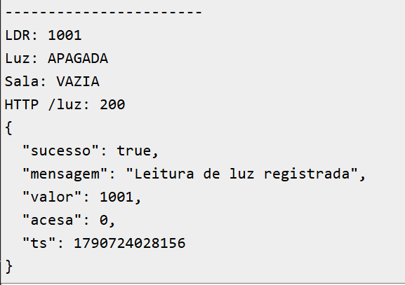
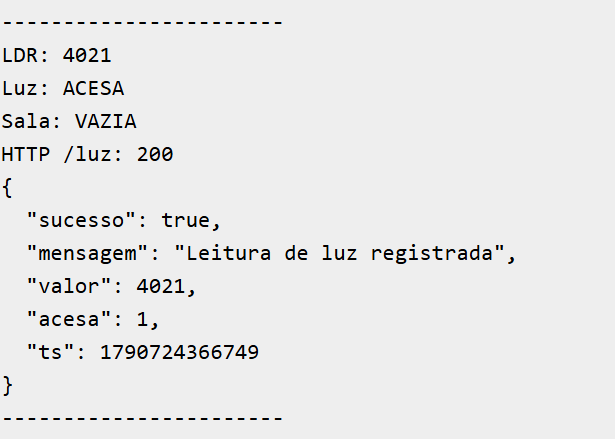
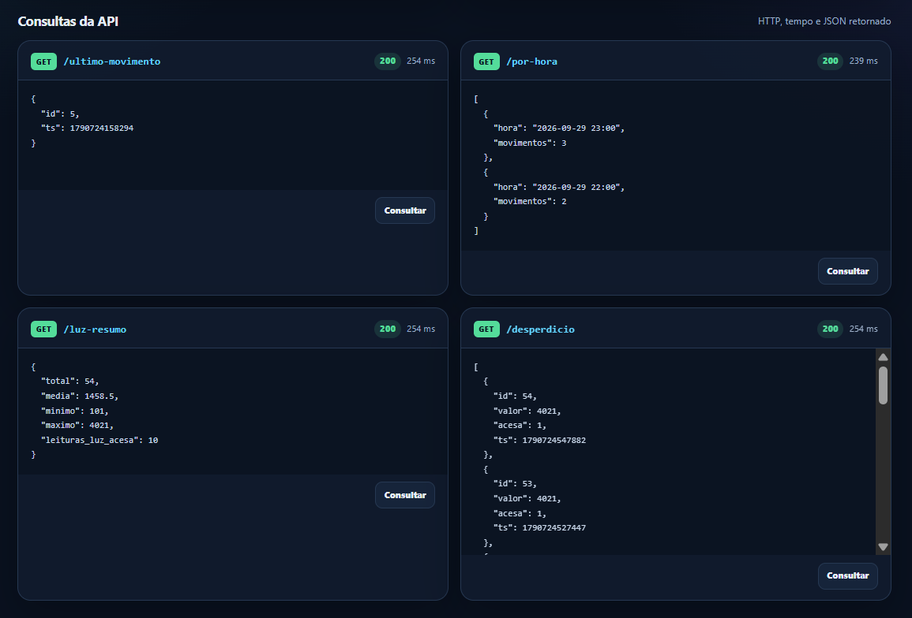

# Projeto IoT — Monitoramento de Sala

## Objetivo

O projeto usa um ESP32 no Wokwi para monitorar movimento e luminosidade de uma sala. As leituras são enviadas por HTTP para um Cloudflare Worker e armazenadas em um banco Cloudflare D1.

Funcionalidades:

- detecção de movimento com sensor PIR;
- leitura de luminosidade com LDR;
- indicação de ocupação pelo LED;
- alerta de desperdício quando a luz permanece acesa sem movimento.

## Entregáveis

- `diagram.json`: circuito do ESP32 no Wokwi;
- `sketch.ino`: firmware do ESP32;
- `worker.js`: API do Cloudflare Worker;
- `dashboard.html`: painel visual para executar e registrar as respostas dos endpoints;
- banco D1 `monitoramento-sala`.

## Painel de testes

Abra o arquivo `dashboard.html` no navegador. O painel permite:

- enviar `POST /movimento`;
- enviar `POST /luz` com valor do LDR e estado da luz;
- consultar todos os endpoints GET individualmente ou em conjunto;
- visualizar código HTTP, tempo de resposta e JSON formatado;
- acompanhar o histórico das chamadas para facilitar os prints da entrega.

O Worker possui suporte a CORS para permitir que o painel seja aberto localmente.

## Wokwi

Projeto: https://wokwi.com/projects/476539449751815169

## Cloudflare Worker

URL: https://flat-recipe-5685.vinidotto02.workers.dev

O Worker usa o binding D1 `DB` e registra o timestamp com `Date.now()`.

### Rotas

| Método | Rota | Função |
|---|---|---|
| POST | `/movimento` | Registra um movimento. |
| POST | `/luz` | Registra `valor` e `acesa`. |
| GET | `/ultimo-movimento` | Retorna o movimento mais recente. |
| GET | `/por-hora` | Agrupa movimentos por hora local (UTC−3). |
| GET | `/luz-resumo` | Retorna total, média, mínimo, máximo, acesas e percentual acesa. |
| GET | `/desperdicio` | Retorna leituras com luz acesa e sem movimento nos 2 minutos anteriores. |

Exemplos:

```bash
curl -X POST https://flat-recipe-5685.vinidotto02.workers.dev/movimento

curl -X POST https://flat-recipe-5685.vinidotto02.workers.dev/luz \
  -H "Content-Type: application/json" \
  -d "{\"valor\":2500,\"acesa\":1}"

curl https://flat-recipe-5685.vinidotto02.workers.dev/ultimo-movimento
curl https://flat-recipe-5685.vinidotto02.workers.dev/por-hora
curl https://flat-recipe-5685.vinidotto02.workers.dev/luz-resumo
curl https://flat-recipe-5685.vinidotto02.workers.dev/desperdicio
```

## Banco D1

```sql
CREATE TABLE IF NOT EXISTS movimentos (
  id INTEGER PRIMARY KEY AUTOINCREMENT,
  ts INTEGER NOT NULL
);

CREATE TABLE IF NOT EXISTS luz (
  id INTEGER PRIMARY KEY AUTOINCREMENT,
  valor INTEGER NOT NULL,
  acesa INTEGER NOT NULL,
  ts INTEGER NOT NULL
);
```

Consultas equivalentes às rotas:

```sql
-- Último movimento
SELECT * FROM movimentos ORDER BY ts DESC LIMIT 1;

-- Movimentos por hora no horário de Brasília
SELECT
  strftime('%H', ts / 1000, 'unixepoch', '-3 hours') AS hora,
  COUNT(*) AS movimentos
FROM movimentos
GROUP BY hora
ORDER BY hora;

-- Resumo de luz
SELECT
  COUNT(*) AS total,
  ROUND(AVG(valor), 2) AS media,
  MIN(valor) AS minimo,
  MAX(valor) AS maximo,
  SUM(CASE WHEN acesa = 1 THEN 1 ELSE 0 END) AS acesas,
  ROUND(
    100.0 * SUM(CASE WHEN acesa = 1 THEN 1 ELSE 0 END)
    / NULLIF(COUNT(*), 0),
    2
  ) AS percentual_acesa
FROM luz;

-- Leituras de desperdício
SELECT l.id, l.valor, l.acesa, l.ts
FROM luz l
WHERE l.acesa = 1
  AND NOT EXISTS (
    SELECT 1
    FROM movimentos m
    WHERE m.ts BETWEEN l.ts - 120000 AND l.ts
  )
ORDER BY l.ts DESC;
```

## Ligações no Wokwi

| Componente | Ligação |
|---|---|
| PIR | VCC → 3V3, GND → GND, OUT → GPIO 27 |
| LDR | VCC → 3V3, GND → GND, AO → GPIO 34 |
| LED | GPIO 2 → ânodo; cátodo → resistor de 220 Ω → GND |

## Regras de funcionamento

- O PIR usa interrupção no GPIO 27; a ISR apenas incrementa `movimentosPendentes`.
- Cada movimento gera um `POST /movimento` no `loop()`.
- A sala fica ocupada por 30 segundos após o último movimento e o LED permanece aceso nesse período.
- O LDR é enviado a cada 20 segundos em `POST /luz`.
- O limiar atual é `LIMIAR_LUZ = 2000`, confirmado com os valores observados no Serial Monitor.
- Com a sala vazia e a luz acesa por 60 segundos, o LED pisca a cada 500 ms.
- `/desperdicio` considera uma leitura de luz acesa sem movimento nos 120000 ms anteriores.

## Serial Monitor

O firmware exibe movimentos, valor do LDR, estado da luz, ocupação, alerta de desperdício, códigos HTTP e respostas do Worker.

## Evidências

As imagens abaixo são evidências reais da execução.

### Serial Monitor — luz apagada



O valor `1001` foi classificado como `APAGADA` e enviado com HTTP 200 (`acesa: 0`).

### Serial Monitor — luz acesa



O valor `4021` foi classificado como `ACESA` e enviado com HTTP 200 (`acesa: 1`).

Com essas leituras, o limiar `LIMIAR_LUZ = 2000` separa os dois estados observados.

### Consultas GET



O painel registra HTTP 200 para:

- `GET /ultimo-movimento`;
- `GET /por-hora`;
- `GET /luz-resumo`;
- `GET /desperdicio`.


